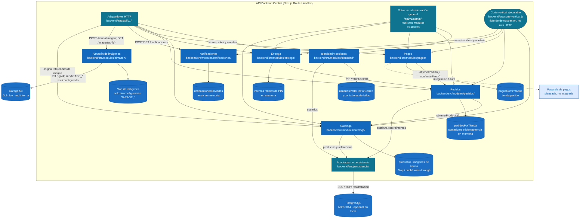

# Diagrama de Componentes — LaPlacita

> Descompone la API Backend Central del C4 de contenedores. Muestra los cinco contextos de dominio definidos en ADR-0005, los módulos de soporte que aparecen en el código actual y los adaptadores HTTP. Esta vista refleja el código de `master` revisado el 07/11/2026.

## Relaciones y límites observables

| Componente | Responsabilidad / relación |
| --- | --- |
| Adaptadores HTTP | Traducen las rutas API a llamadas de módulos y aplican autenticación/autorización en las rutas protegidas. La identidad y el rol se resuelven con el módulo `identidad`. |
| Administración general | No es un contexto de dominio nuevo. Las rutas `/admin/*` validan `superadmin` y delegan lecturas o cambios en `pedidos`, `pagos`, `entrega` y `catalogo` (ADR-0037). |
| Contextos de dominio | Catálogo, Pedidos, Pagos, Entrega y Notificaciones, conforme a ADR-0005. Pedidos consulta Catálogo; Pagos y Entrega usan métodos de intención de Pedidos. Identidad y Almacén son módulos de soporte en esta vista. |
| Identidad | Módulo de soporte para cuentas, contraseñas, roles efectivos y sesiones firmadas. Persiste usuarios mediante el adaptador de persistencia; los fallos de acceso se cuentan en memoria. |
| Almacén de imágenes | Módulo de soporte para bytes y validación de formato. Usa Garage con `GARAGE_*`; sin esa configuración conserva un Map temporal en memoria. Catálogo guarda las referencias, no los bytes. |
| Persistencia | Comparte el acceso a PostgreSQL y la rehidratación. La cola de escritura de pedidos tiene reintentos at-least-once; no vuelve durable la idempotencia, que sigue en memoria. |
| Notificaciones | El módulo guarda un historial en memoria y expone rutas HTTP. El corte vertical lo invoca después de sus transiciones de demostración; las rutas productivas de pago, Listo, entrega y cancelación no publican automáticamente esos eventos en el estado actual revisado. El historial de A-03 es parcial. |
| PostgreSQL y Garage | PostgreSQL guarda datos estructurados y referencias. Garage almacena los bytes de las imágenes en la red privada de Dokploy. En local puede faltar cualquiera de las dos configuraciones, con los modos temporales descritos. |

## Leyenda

| Color | Significado |
| --- | --- |
| Azul (`module`) | Módulo de backend. Solo los cinco contextos indicados en ADR-0005 se etiquetan como contextos de dominio; identidad y almacén se muestran como módulos de soporte. |
| Azul medio (`store`) | Almacén de datos o servicio de almacenamiento. Los `Map` y el arreglo son memoria del proceso. |
| Verde azulado (`adapter`) | Adaptador HTTP, persistencia o flujo ejecutable de demostración. |
| Azul claro discontinuo | Integración futura, no activa. |

## Referencias de implementación

- Rutas HTTP y contrato: `backend/app/api/v1/` y `backend/openapi.yaml`.
- Módulos: `backend/src/modules/{catalogo,pedidos,pagos,entrega,notificaciones,identidad,almacen}/`.
- Persistencia y estado compartido: `backend/src/persistencia/index.js` y `backend/src/estado-compartido.js`.
- Almacén de imágenes: `backend/src/modules/almacen/index.js`, ADR-0028 y ADR-0035.
