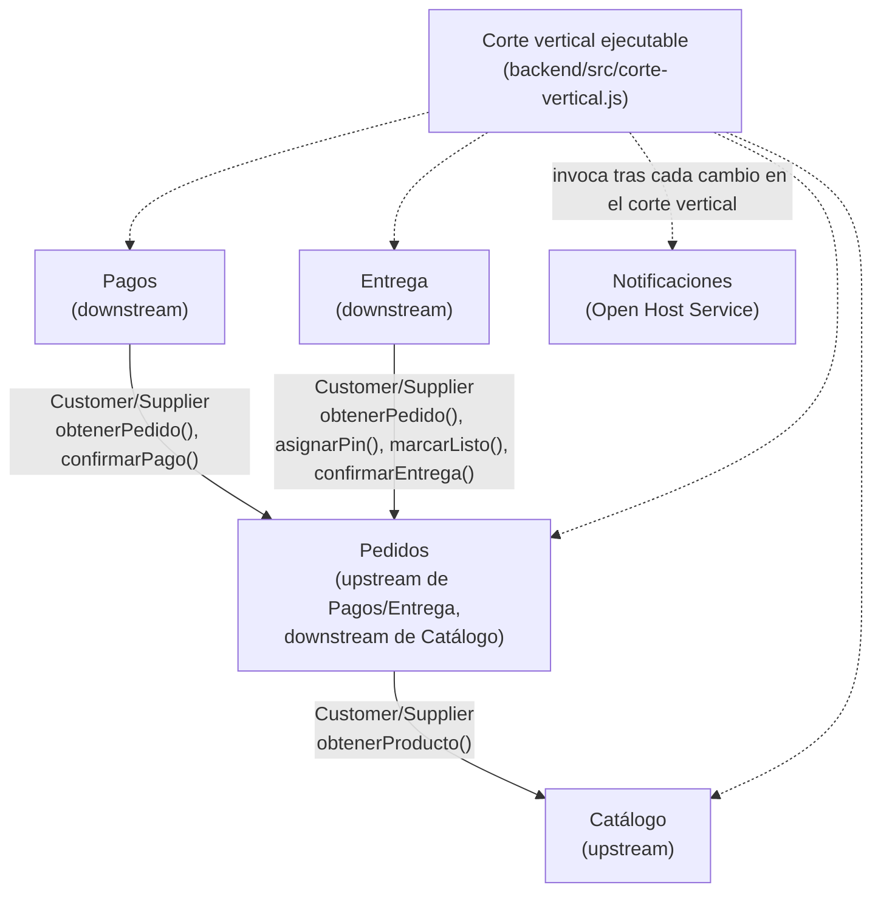

# Mapa de Contextos — La Placita

## Relaciones

| Relación | Patrón DDD | Descripción |
| --- | --- | --- |
| Pedidos → Catálogo | Customer/Supplier | Pedidos consulta `obtenerProducto` para validar precio y pertenencia a tienda antes de crear el pedido. |
| Pagos → Pedidos | Customer/Supplier | Pagos lee el pedido y solo puede avanzar su estado a "En preparación" invocando `pedidos.confirmarPago` (V-03). |
| Entrega → Pedidos | Customer/Supplier | Entrega lee el pedido, pide el `pin` con `pedidos.asignarPin` (V-01) y avanza su estado a "Listo"/"Entregado" invocando `pedidos.marcarListo` y `pedidos.confirmarEntrega` (V-03). |
| Notificaciones | Open Host Service | Expone `notificarCambioEstado` y lectura del historial. El corte vertical la invoca tras sus transiciones; las rutas productivas de pago, Listo, entrega y cancelación no publican automáticamente esos eventos. A-03 permanece parcial. |

## Nota
El orquestador (`backend/src/corte-vertical.js`) no es un contexto de dominio: es un flujo ejecutable de demostración que compone los cinco contextos originales. No es el adaptador de las rutas de producción ni tiene datos propios. Identidad y Almacén son módulos de soporte incorporados después; se muestran en el C4 de componentes sin reclasificarlos como nuevos contextos de dominio.
