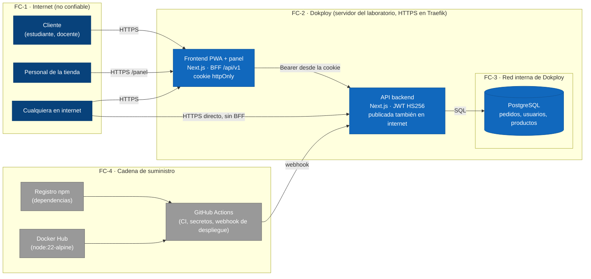

# Evidencia S13 — Modelado de amenazas y plan de mitigación

Documento del 2026-10-28, **pendiente de validación del equipo**.
Responde a la Evidencia S13 de SAVIO con tres entregables:

1. Tabla de amenazas priorizadas con su mitigación y responsable (§3).
2. Resultado del análisis de dependencias (§5).
3. Sección de privacidad: qué datos personales se tratan y con qué base (§6).

Material de referencia: presentación de la semana 13, OWASP Top 10, OWASP Top 10 for LLM
Applications y la documentación de `npm audit` y `npm sbom`.

**Reglas de este documento:**
- Solo aparecen amenazas sobre piezas que existen en el código o en el despliegue, y cada
  mitigación cita dónde se cumple.
- «Mitigada» quiere decir que hay código o configuración en el repositorio y una verificación
  ejecutada (§5.1). Lo que depende de un ajuste fuera del repositorio (GitHub, Dokploy) se marca
  «pendiente» con su responsable.
- La arquitectura de seguridad queda en arc42 §8.6 y las amenazas aceptadas en arc42 §14.
  La única mitigación que cambia la estructura tiene su ADR
  ([ADR-0027](../adr/0027-rutas-v1-de-tienda-con-sesion.md)).

---

## 1. Las cuatro preguntas del modelado

| Pregunta | Respuesta corta | Dónde |
|---|---|---|
| ¿Qué estamos construyendo? | Una PWA y un panel de tienda (Next.js) que hablan con una API (Next.js) y una base PostgreSQL, todo en Dokploy | §2 |
| ¿Qué puede salir mal? | 19 amenazas STRIDE. La peor: cualquiera podía pagar, marcar listo y obtener el PIN de un pedido ajeno | §3 |
| ¿Qué vamos a hacer? | 7 amenazas mitigadas esta semana, 5 ya cubiertas por ADR anteriores, 3 parciales con plan y 4 riesgos aceptados con su razón | §3, §4 |
| ¿Lo hicimos bien? | Pruebas automáticas, recorrido HTTP 14/14, `npm audit` en 0 y prueba de inventario que impide nuevas rutas de escritura sin sesión | §5 |

---

## 2. Qué estamos construyendo: C4 nivel 2 con fronteras de confianza

Es el mismo C4 de [contenedores](../c4/contenedores.md), con las **fronteras de confianza**
marcadas. Cada flecha que cruza una frontera es un lugar donde el modelado busca amenazas.



Hechos que importan para las amenazas:

- **El backend está publicado en internet** (`laplacita-test.iscoutb.dev`), no solo detrás del
  BFF. Toda ruta de la API es alcanzable sin pasar por la app.
- Los ids de pedido son secuenciales (`pedido-N`, ADR-0024) y las tiendas son `tienda-01`…`05`.
  Un atacante no tiene que adivinar nada.
- Las cuentas de tienda no se registran: se declaran en `CUENTAS_TIENDA`, un secreto de Dokploy
  (ADR-0023).
- **No hay pasarela de pagos ni servicio push en producción**: el pago se confirma a mano en el
  mostrador. No se tratan datos de tarjetas.
- **No hay componente de IA generativa** en el sistema (ADR-0012). Ver §7.

### Quién querría atacarlo, por dónde y qué ganaría

| Atacante | Motivo | Puerta probable |
|---|---|---|
| Estudiante oportunista | Comer sin pagar o «colarse» en la fila | API pública: rutas de pago y entrega, PIN |
| Bromista | Molestar: avisos falsos, pedidos basura | Notificaciones, creación sin cuenta |
| Personal de otra tienda | Ver ventas o sabotear a la competencia | Panel: operar otra tienda (ESC-02) |
| Bot de internet | Probar contraseñas filtradas, buscar fallos conocidos | Login, versiones vulnerables del framework |
| Paquete o imagen comprometida | Robar secretos del CI o del servidor | npm, Docker Hub, acciones de GitHub |

---

## 3. Tabla de amenazas priorizadas (STRIDE)

**Escala:** probabilidad (P) e impacto (I) de 1 a 3. Riesgo = P × I.
**Prioridad:** alta 6–9, media 3–4, baja 1–2. «Antes» es el riesgo al empezar S13; «Después»
es el riesgo residual con las mitigaciones de la columna.

Responsables:
- **Miguel** (isaza927) y **Mateo**. Cualquiera de los dos puede tomar cualquier fila.
- El responsable es quien responde por la fila, no necesariamente quien la programó.

| ID | STRIDE | Elemento | Amenaza | P | I | Antes | Mitigación | Estado | Después | Resp. |
|---|---|---|---|---|---|---|---|---|---|---|
| T-01 | S, T, E | API: `POST /pagos/{id}/confirmar`, `/entrega/{id}/listo`, `/entrega/{id}/validar` | Cualquiera en internet marca pagado un pedido ajeno, lo marca listo **y recibe su PIN**, y lo retira sin pagar. Una cuenta de una tienda opera otra | 3 | 3 | **9** | Sesión de una cuenta de **esa** tienda, con 401 y 403 ([ADR-0027](../adr/0027-rutas-v1-de-tienda-con-sesion.md), `src/http/acceso-tienda.js`) | Mitigada (S13) | 3 | Mateo |
| T-02 | S, T | API: `POST /notificaciones` | Un bromista escribe «tu pedido está listo» en el historial del cliente, que va a la tienda por nada | 3 | 2 | **6** | Misma regla de ADR-0027 | Mitigada (S13) | 1 | Mateo |
| T-03 | T, E | Cadena de suministro: dependencias npm | Una dependencia con vulnerabilidad conocida, o un paquete comprometido, entra al build y llega a producción | 2 | 3 | **6** | Job `dependencias` del CI con `npm audit --audit-level=high` y SBOM; `.github/dependabot.yml` semanal; `npm ci` con lockfile; se quitan 3 dependencias sin uso (§5) | Mitigada (S13) | 3 | Miguel |
| T-04 | S | API: `POST /auth/sesion` | Un bot prueba contraseñas filtradas contra muchos correos (*credential stuffing*) | 2 | 2 | 4 | Ya existía: bloqueo tras 5 fallos en 15 min **por correo**, mismo mensaje para correo inexistente (ADR-0021). Falta: límite **por IP** en Traefik (middleware `rateLimit` de Dokploy) | Parcial; pendiente | 4 | Mateo |
| T-05 | S | API: `POST /auth/registro` | Alguien registra el correo UTB de otra persona: no se verifica que el correo sea suyo | 2 | 2 | 4 | Sin servicio de correo para enviar un enlace de verificación | **Aceptada** (arc42 §14, R-S13-1) | 4 | Miguel |
| T-06 | I | Frontend: URL `/pedidos/{id}?seguimiento=…` | El token de seguimiento viaja en la URL y se filtra por la cabecera `Referer` hacia otros sitios | 2 | 2 | 4 | Ya existía: token de 128 bits (ADR-0025). Nuevo: `Referrer-Policy: same-origin` en todas las páginas (`frontend/next.config.mjs`) | Mitigada (S13) | 2 | Miguel |
| T-07 | D | API: `POST /pedidos` sin cuenta; cuerpos grandes | Un bot inunda la cola de una tienda con pedidos basura o envía cuerpos enormes | 2 | 2 | 4 | Ya existía: idempotencia (S11), y un pedido falso no avanza sin la tienda. Falta: límite por IP y tamaño máximo del cuerpo en Traefik | Parcial; pendiente | 4 | Mateo |
| T-08 | R | Panel de tienda | Un cajero niega haber confirmado un pago o entregado un pedido | 2 | 2 | 4 | Nuevo: la bitácora de cada acción del panel registra `usuarioId` (id seudónimo, nunca el correo) junto a `tiendaId` y `pedidoId` (`src/logger.js`) | Mitigada (S13) | 2 | Mateo |
| T-09 | D | PostgreSQL caído | Se pierden escrituras o se reasignan ids | 2 | 2 | 4 | Ya existía: escrituras at-least-once con DLQ y creación confirmada (ADR-0026) | Mitigada (S12) | 2 | Mateo |
| T-10 | E | Contenedores Docker | Si alguien ejecuta código en el servidor Node, controla el contenedor porque corre como root | 1 | 3 | 3 | Nuevo: `USER node` y `COPY --chown` en los dos Dockerfile; Dependabot vigila la imagen base. Falta: fijar `node:22-alpine` por digest | Mitigada (S13); digest pendiente | 2 | Mateo |
| T-11 | T | GitHub Actions | Una acción de terceros comprometida (`actions/checkout@v4` es una etiqueta móvil) roba el webhook de despliegue o el token de Sonar | 1 | 3 | 3 | Nuevo: Dependabot para `github-actions`. Falta: fijar las acciones por SHA | Parcial; pendiente | 3 | Miguel |
| T-12 | S, E | `JWT_SECRET` | Con el secreto se firma un token de admin de cualquier tienda | 1 | 3 | 3 | Ya existía: ≥32 caracteres obligatorio en producción, vive en *Environment* de Dokploy, `alg: none` rechazado (prueba). Falta: procedimiento de rotación | Mitigada; rotación pendiente | 3 | Mateo |
| T-13 | I | Repositorio y CI | Un secreto (contraseña de la base, `CUENTAS_TIENDA`) termina en un commit | 1 | 3 | 3 | Ya existía: `.env` ignorado, `.env.example` sin valores, secretos en GitHub Actions y Dokploy. Falta: activar *secret scanning* y *push protection* en GitHub (ajuste del repositorio) | Mitigada; ajuste pendiente | 2 | Miguel |
| T-14 | I | Sesión en el navegador | Un XSS roba la sesión | 1 | 3 | 3 | Ya existía: cookie `httpOnly`, `SameSite=Lax` y `Secure` (ADR-0021); React escapa el contenido. Sin CSP completa (`script-src`) | Mitigada; CSP **aceptada** (R-S13-2) | 3 | Miguel |
| T-15 | I | Copia de la base de datos | Quien obtenga una copia de PostgreSQL ve correos, PIN y tokens de seguimiento | 1 | 3 | 3 | Ya existía: la base solo está en la red interna de Dokploy (ADR-0014) y las contraseñas van con scrypt. PIN y token en claro | Mitigada; PIN en claro **aceptado** (R-S13-3) | 3 | Mateo |
| T-16 | E | Panel: catálogo | Un cajero (`trabajador`) cambia precios | 1 | 2 | 2 | Ya existía: rol `admin` exigido para precios (ADR-0023, `tests/panel-tienda.test.js`) | Mitigada | 2 | Mateo |
| T-17 | I | Ventanilla: PIN de 4 dígitos | Probar PIN hasta acertar | 1 | 2 | 2 | Ya existía: 5 intentos y bloqueo (A-06), PIN de un solo uso. Nuevo: validar exige la sesión de la tienda (T-01) | Mitigada | 1 | Mateo |
| T-18 | T | Panel en un iframe | *Clickjacking*: una página ajena incrusta el panel y engaña al cajero para que haga clic | 1 | 2 | 2 | Nuevo: `X-Frame-Options: DENY` y `frame-ancestors 'none'` | Mitigada (S13) | 1 | Miguel |
| T-19 | I | `GET /metricas` y `/docs` públicos | Se ven contadores, el tamaño de la DLQ y el contrato | 2 | 1 | 2 | No exponen datos personales; `/metricas` se usa para medir en S14 | **Aceptada** (R-S13-4) | 2 | Mateo |

**Resultado:** las dos amenazas de prioridad alta (T-01 y T-02) y la de la cadena de suministro
(T-03) quedan mitigadas y verificadas. Ninguna amenaza queda con riesgo residual alto. Las de
riesgo 4 que siguen abiertas (T-04, T-05, T-07) tienen plan o aceptación explícita.

---

## 4. Plan de lo que queda pendiente

Ordenado por riesgo residual. Lo que se hace fuera del repositorio necesita acceso de
administrador a GitHub o a Dokploy.

| # | Acción | Amenaza | Dónde | Resp. | Fecha |
|---|---|---|---|---|---|
| P-1 | Middleware `rateLimit` de Traefik para el backend y el frontend (por IP), con un tope de tamaño del cuerpo | T-04, T-07 | Dokploy → dominio → Middlewares | Mateo | 04/11/2026 (antes de medir en S14) |
| P-2 | Activar *Dependabot alerts*, *secret scanning* y *push protection* | T-03, T-13 | GitHub → Settings → Code security | Miguel | 31/10/2026 |
| P-3 | Fijar las acciones de GitHub por SHA y la imagen `node:22-alpine` por digest (Dependabot las mantiene al día) | T-10, T-11 | `.github/workflows/*.yml`, `*/Dockerfile` | Miguel | 08/11/2026 |
| P-4 | Escribir el procedimiento de rotación de `JWT_SECRET`: cambiarlo en Dokploy y redesplegar cierra todas las sesiones | T-12 | `docs/` | Mateo | 08/11/2026 |
| P-5 | Guardar con la cuenta la versión del aviso de privacidad aceptada, como prueba de la autorización | §6 | `usuarios` + `POST /auth/registro` | Miguel | Entrega final |
| P-6 | Validar en equipo ADR-0027 y esta evidencia | — | — | Ambos | 31/10/2026 |

---

## 5. Análisis de dependencias y cadena de suministro

### 5.1 Resultado del análisis (28/10/2026)

Herramienta: `npm audit` (base de avisos de GitHub) sobre los dos lockfiles, en Node 24 y
npm 11.12.1 locales.

| Paquete | Antes | Hallazgo | Corrección | Después |
|---|---|---|---|---|
| `backend` | 0 vulnerabilidades | — (la migración a Next 16 del 22/10 ya cerró el riesgo R-5 de S8) | — | **0** |
| `frontend` | **1 alta** | `zod <4.6.6`: puede agotar la memoria al validar colecciones grandes con restricciones ([GHSA-mrhx-c7xc-m3w5](https://github.com/advisories/GHSA-mrhx-c7xc-m3w5)). Llegaba por dos caminos: como dependencia directa **que ningún archivo importa** (resto de la plantilla v0) y a través de `eslint-plugin-react-hooks`, solo en desarrollo | Se borran `zod`, `@hookform/resolvers` y `react-hook-form`, que no se usan (menos superficie). `overrides.zod = ^4.6.7` para la copia del linter, que acepta `^3.25 \|\| ^4` | **0** |

`npm audit fix --force` se descartó: instalaba `zod@4.6.7` como dependencia directa sin uso, en
lugar de quitarla.

**Verificación de la mitigación T-01/T-02 (ADR-0027).** Recorrido HTTP sobre el build de
producción del backend (`node .next/standalone/server.js`, sin base, con cuentas de prueba de
`tienda-01` y `tienda-02`): **14/14** respuestas como se esperaba.

| Caso | Esperado | Obtenido |
|---|---|---|
| Pago sin sesión | 401 | 401 |
| Pago con sesión de cliente | 403 | 403 |
| Pago con cuenta de `tienda-02` sobre pedido de `tienda-01` | 403 | 403 |
| Pago con cuenta de `tienda-01` | 200 | 200 |
| Listo sin sesión (antes devolvía el PIN) | 401 | 401 |
| Listo con cuenta de `tienda-01` | 200 | 200 |
| Validar PIN sin sesión | 401 | 401 |
| Validar PIN con cuenta de `tienda-02` | 403 | 403 |
| Validar PIN con cuenta de `tienda-01` | 200 | 200 |
| Notificación falsa sin sesión | 401 | 401 |
| Notificación con cuenta de `tienda-02` | 403 | 403 |
| Notificación con cuenta de `tienda-01` | 201 | 201 |
| Pedido sin cuenta (sigue abierto a propósito) | 201 | 201 |
| Panel `GET /tienda/pedidos` con `tienda-01` | 200 | 200 |

Además:
- `medir-exposicion-pin.js --url` con sesión de tienda: 0/100 lecturas con PIN y 0/100 PUT con
  efecto. ESC-03 se sigue cumpliendo.
- Cabeceras del frontend construido: `Referrer-Policy`, `X-Frame-Options`, `frame-ancestors`,
  `nosniff` y `Permissions-Policy` presentes en `/`. `Referrer-Policy` comprobada también en
  `/api/v1/health` del BFF.
- Revisión visual en móvil (375 px) de `/privacidad` y de «Crear cuenta» con la casilla.
- Pruebas del backend (`npm test`): con PostgreSQL 18 local, 119 en verde y 1 omitida; sin
  base, 114 en verde y 6 omitidas. Contrato: 28/28. Frontend: lint y build sin errores.

### 5.2 El análisis queda en el pipeline

Job nuevo `dependencias` en `.github/workflows/ci.yml`, en paralelo para `backend` y `frontend`:

1. `npm audit --audit-level=high`: **el CI falla** si aparece una vulnerabilidad alta o crítica.
   Las moderadas y bajas se ven en el log y en Dependabot, pero no bloquean.
2. `npm sbom --sbom-format cyclonedx`: genera el SBOM y lo publica como artefacto del run
   (`sbom-backend`, `sbom-frontend`). En local: 68 componentes en el backend y 466 en el
   frontend. En el frontend se omiten las dependencias opcionales, porque el binario wasm de
   Tailwind trae un lockfile interno inconsistente y `npm sbom` se niega a generarlo.

### 5.3 Resto de la cadena de suministro

| Eslabón | Estado | Cambio en S13 |
|---|---|---|
| Lockfiles | `npm ci` en el CI y en los Dockerfile: se instala exactamente lo del lockfile | — |
| Actualizaciones | Antes solo había alertas | `.github/dependabot.yml`: PR semanales para npm (backend y frontend), Docker y GitHub Actions |
| Imagen base | `node:22-alpine`, etiqueta móvil, contenedor como root | `USER node` en los dos Dockerfile; digest pendiente (P-3) |
| Acciones del CI | Etiquetas `@v4`/`@v5` | Dependabot las vigila; fijar por SHA pendiente (P-3) |
| Secretos | GitHub Actions (`SONAR_TOKEN`, webhook de Dokploy) y *Environment* de Dokploy (`DATABASE_URL`, `JWT_SECRET`, `CUENTAS_TIENDA`) | Activar *secret scanning* pendiente (P-2) |
| Análisis estático | SonarCloud con Quality Gate bloqueante (ADR-0016) | — |

---

## 6. Privacidad: qué datos personales se tratan y con qué base

### 6.1 Inventario

| Dato | Dónde vive | Finalidad | Quién lo ve | Base | Conservación |
|---|---|---|---|---|---|
| Correo institucional | `usuarios.correo` | Identificar la cuenta e iniciar sesión | El titular. **Ninguna tienda** | Autorización del titular al registrarse (Ley 1581 de 2012, art. 9), con aviso de privacidad | Mientras dure el proyecto (semestre 2026-2) |
| Nombre | `usuarios.nombre` | Que la tienda sepa a quién entregar | El titular. La tienda ve **solo el primer nombre** (`nombreCorto`, ADR-0023) | Igual | Igual |
| Contraseña | `usuarios.hash` (scrypt con sal) | Iniciar sesión | Nadie: no es reversible | Igual | Igual |
| Pedidos (producto, cantidad, total, estado, fecha) | `pedidos` | Preparar, cobrar y entregar; historial del cliente; resumen de ventas de la tienda | El titular y la tienda del pedido | Ejecución del servicio que el titular pide | Igual |
| `clienteId` | `pedidos.cliente_id` | Ligar el pedido a su dueño | Interno | Igual | Igual |
| PIN de retiro y token de seguimiento | `pedidos.pin`, `pedidos.seguimiento` | Entregar al dueño y dejarle seguir el pedido sin cuenta | El dueño (el PIN, ADR-0022) | Igual | Igual. El PIN deja de servir al entregar |
| Bitácora | stdout del contenedor | Operar y auditar | El equipo, en Dokploy | Interés legítimo de seguridad | Lo que guarde Dokploy; se pierde al redesplegar |

**Qué no se trata:** datos de tarjetas (el pago es en el mostrador), ubicación, cámara,
teléfono, documento de identidad, analítica de terceros ni publicidad. La bitácora no registra
el correo, el nombre, el PIN ni el token: usa `usuarioId` (`usr-…`), `tiendaId` y `pedidoId`.

### 6.2 Minimización (lo que ya hace el diseño)

- **Pedido sin cuenta:** el contrato v1 permite pedir sin registrarse; el pedido queda en el
  dispositivo y se sigue con el token (ADR-0025).
- **La tienda ve lo mínimo:** primer nombre, código corto y estado. Nunca el correo ni el PIN.
- **Solo correo institucional** (`DOMINIOS_CORREO`): no se recogen correos personales.
- **Contraseñas con scrypt** y sin dependencias externas (ADR-0021).
- **El PIN solo lo ve su dueño** (ADR-0022), y la vista pública del pedido no lo incluye
  (ADR-0013).

### 6.3 Base legal y derechos del titular

- Proyecto académico en Colombia: aplica la **Ley 1581 de 2012** y el Decreto 1377 de 2013.
  El tratamiento necesita **autorización previa, expresa e informada**.
- **Hecho en S13:**
  - Página `/privacidad` (`frontend/app/privacidad/page.tsx`): qué datos, para qué, qué no se
    hace y los derechos del titular (conocer, actualizar, rectificar, suprimir, revocar), con
    plazos de 10 días hábiles para consultas y 15 para reclamos.
  - Casilla **obligatoria** de autorización en «Crear cuenta», con enlace al aviso
    (`frontend/app/cuenta/page.tsx`).
- **Pendientes declarados:**
  - La autorización se pide en el navegador, pero el servidor no guarda qué versión del aviso
    aceptó cada cuenta (P-5).
  - No hay un botón para borrar la cuenta. La supresión se atiende a mano: borrar la fila de
    `usuarios` y desligar sus pedidos.
  - El aviso dice «escríbenos al equipo del proyecto», pero todavía no tiene un correo de
    contacto: falta poner uno.

---

## 7. Riesgos propios de aplicaciones con IA generativa

**El sistema no tiene un componente de IA generativa** ([ADR-0012](../adr/0012-no-incorporar-componente-generativo.md)):
no hay prompts, contexto ni modelo en producción. Por eso los riesgos del OWASP Top 10 for LLM
**no aplican al producto**:
- inyección de prompt (LLM01);
- revelación de datos sensibles (LLM02);
- envenenamiento de datos y del contexto (LLM04);
- agencia excesiva (LLM06).

Sí aplica al **proceso de desarrollo**, porque el equipo usa asistentes de código
([docs/ia.md](../ia.md)):

| Riesgo | Mitigación vigente |
|---|---|
| Código generado con un fallo de seguridad que nadie revisa | Revisión del equipo antes de cada commit, pruebas automáticas, SonarCloud con gate bloqueante, y la prueba de inventario de rutas de esta semana |
| Dependencia «alucinada» o con nombre parecido (*slopsquatting*) | Toda dependencia nueva pasa por un ADR o por `docs/ia.md` y por `npm audit` en el CI. Esta semana se **quitaron** 3 dependencias en vez de agregar |
| Instrucciones escondidas en contenido que lee el asistente (páginas, archivos) | El asistente trata ese contenido como datos y no hace commit ni push: lo hace el equipo |
| Secretos pegados en el chat del asistente | Los secretos viven en Dokploy y GitHub, nunca en el repositorio ni en los prompts. `docs/ia.md` no los registra |

Si en un corte futuro se incorpora un componente generativo, ADR-0012 exige un ADR nuevo, y ese
ADR debe traer su propio modelado con el OWASP Top 10 for LLM.

---

## 8. Reproducción

```bash
# Pruebas de la mitigación y de la regla de inventario de rutas
cd backend && node --test tests/seguridad-s13.test.js

# Análisis de dependencias como lo corre el CI
cd backend && npm audit --audit-level=high
cd frontend && npm audit --audit-level=high

# Medición ESC-03 contra un backend construido, con una cuenta de tienda-01
CORREO_TIENDA=<correo> CLAVE_TIENDA=<clave> node backend/scripts/medir-exposicion-pin.js --url http://localhost:3000
```
