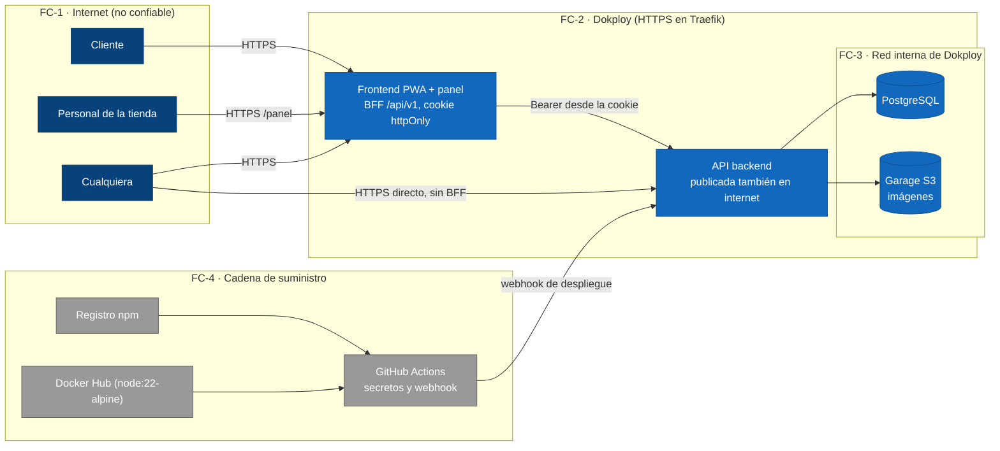

# Evidencia S13 — Seguridad y riesgos

Documento del 2026-10-25 (semana S13, 26/10–01/11). Responde a la Evidencia S13 de SAVIO:
tabla de amenazas STRIDE priorizada con mitigación y responsable, resultado del análisis de
dependencias y sección de privacidad. Material: plan de ejecución S12–S15, auditoría de
superficie del 25/10 y [ADR-0029](../adr/0029-superficie-publica-minima.md).

**Regla del documento:** cada amenaza cita su defensa con archivo:línea o se declara aceptada
con su justificación. Nada de "seguridad fingida": lo que no está implementado figura en la
tabla como **aceptada** o **pendiente**, nunca como mitigado.

---

## 1. Base de la revisión: cómo se protege una petición

| Capa | Mecanismo | Código / ADR |
|---|---|---|
| Sesión | Token propio firmado HMAC-SHA256 (`node:crypto`, sin dependencias — ADR-0021), vía BFF con cookie `httpOnly`, `SameSite=Lax`, `Secure`; el navegador nunca ve el token | `backend/src/modules/identidad/`, `frontend/app/api/v1/[...path]/route.js` |
| Identidad de la tienda | El `tiendaId` SIEMPRE sale del token; ninguna ruta lo recibe del cliente (ESC-02) | `src/http/autenticacion.js` (`cuentaDeTienda`) |
| Roles | `cliente` / `trabajador` / `admin`; el precio solo lo cambia el admin (403) | `src/modules/catalogo/index.js` |
| PIN | Solo lectura para su dueño y con pedido en Listo (ADR-0022); vista pública sin PIN (ADR-0013); logs enmascarados | `pedidos/[pedidoId]/pin/route.js`, `src/logger.js` |
| Contraseñas | scrypt con sal aleatoria (formato `scrypt$N$sal$derivada`) | `src/modules/identidad/contrasenas.js` |
| Límites | 5 fallos de login → bloqueo temporal (429); 5 intentos de PIN | `src/modules/identidad/index.js`, `src/modules/entrega/index.js` |
| Superficie | Retiro de rutas v1 de entrega y pago solo del dueño (ADR-0029, este sprint) | `openapi.yaml`, `tests/contract-openapi.test.js` (S13) |

## 2. Inventario de superficie pública (auditoría 25/10/2026)

| Ruta | Sesión | Nota |
|---|---|---|
| `POST /auth/registro`, `POST /auth/sesion` | — (es el login) | Límite de intentos activo |
| `GET /auth/yo` | ✔ usuario | |
| `GET /health`, `GET /openapi` | — | Estado y contrato (documento, sin datos) |
| `GET /catalogo/tiendas`, `/catalogo/productos/{id}`, `/catalogo/tiendas/{id}/productos` | — | Contenido público del menú |
| `GET /imagenes/{id}` | — | uuid v4 no enumerable; sniffing + `nosniff` (ADR-0028) |
| `GET /metricas` | — | **Aceptada** (ver A-10) |
| `GET /notificaciones`, `/notificaciones/{id}` | usuario | Historial del pedido |
| `POST /pedidos` | ✔ cliente | Idempotencia; el total lo calcula el servidor |
| `GET /pedidos`, `GET /pedidos/{id}`, `GET /pedidos/{id}/pin` | ✔ cliente | Pin solo dueño + Listo (ADR-0022) |
| `POST /pagos/{id}/confirmar` | ✔ **dueño** | ADR-0029 (antes v1 sin sesión) |
| `POST /tienda/*` (pedidos, productos, imagen, resumen) | ✔ tienda | `tiendaId` del token (ESC-02) |
| ~~`POST /entrega/{id}/listo`, `/entrega/{id}/validar`~~ | — | **RETIRADAS** (ADR-0029) |

## 3. Tabla STRIDE priorizada

Prioridad = probabilidad × impacto a la vista del estado real del sistema (un solo proceso,
1 instancia por servicio, red interna de Dokploy). Responsables: M = Mateo (backend/datos),
G = Miguel (frontend).

| # | STRIDE | Amenaza | Vector | Prioridad | Mitigación (o decisión) | Estado | Resp. |
|---|---|---|---|---|---|---|---|
| A-01 | **T** | Confirmar el pago de un pedido ajeno | `POST /pagos/{id}/confirmar` sin sesión + id enumerable | **Alta** (probable y de impacto directo en negocio) | Sesión de dueño: comparación `clienteId` del token vs. pedido; 403 en caso contrario (ADR-0029) | ✅ Mitigada (25/10) | M |
| A-02 | **T / E** | Marcar pedido Listo o validar PIN sin cuenta | Rutas v1 `entrega/*` sin sesión | **Alta** | Retiro de la superficie: rutas y contrato eliminadas (ADR-0029); aserciones de ausencia en el CI | ✅ Mitigada (25/10) | M |
| A-03 | **S** | Suplantar a una tienda (subir foto, cambiar menú, ver cola) | Token falsificado o robado | Alta | Firma HMAC del token + cookie `httpOnly`/`Secure`/`SameSite=Lax` (ADR-0021); `tiendaId` del token (ESC-02); backend revalida en cada ruta | ✅ Mitigada | M |
| A-04 | **I** | Ver el PIN de un pedido ajeno | Vista pública, logs, reenvío | Alta | Vista pública sin PIN (ADR-0013); `GET /pedidos/{id}/pin` solo dueño + Listo (ADR-0022); seguimiento por token de un solo uso (ADR-0025); logs enmascaran | ✅ Mitigada | M |
| A-05 | **I** | Subida de archivos disfrazados de imagen (XSS/JS activo) | Campo multipart del panel | Alta | MIME por sniffing de bytes mágicos + whitelist webp/png/jpeg + `nosniff` + uuid nuevo por subida (ADR-0028; 9 pruebas) | ✅ Mitigada | M |
| A-06 | **E** | Trabajador escala a admin (cambia precios) | `PATCH /tienda/productos/{id}` | Media | Rol verificado en el dominio (403); el rol viaja en el token | ✅ Mitigada | M |
| A-07 | **D** | Fuerza bruta de credenciales | `POST /auth/sesion`, PIN de entrega | Media | 5 fallos → bloqueo temporal 429 (login); 5 intentos de PIN | ✅ Mitigada | M |
| A-08 | **D** | Subida masiva de archivos (DoS de disco/red) | multipart repetido | Media | Límite 512 KB sobre el buffer real + timeout de 10 s al almacén (ADR-0028) | ✅ Mitigada | M |
| A-09 | **S** | Cliente opera pedidos de otro cliente | Enumeración de `pedido-N` (ADR-0024) | Media | Lecturas y transiciones exigir dueño: `GET /pedidos/{id}/pin` (ADR-0022), pago (ADR-0029). **El resto de lecturas por id se endurece con «Mis pedidos» por cuenta (S13, en curso)** | 🟡 Parcial | M |
| A-10 | **I** | Divulgación de información operacional | `GET /metricas` pública | **Baja** (contadores agregados, sin datos personales ni de pedidos) | **Aceptada**: se usa para la evidencia ESC-01 y el monitoreo; restringirla rompería la medición sin cerrar un vector real | ✅ Aceptada | M |
| A-11 | **D** | Dependencias vulnerables (cadena de suministro) | `npm install` | Media | Job `npm audit --audit-level=high` bloquea el CI (backend y frontend) + Dependabot semanal. Resultado 25/10: backend 0 vulnerabilidades; frontend: 1 high (zod, toolchain de eslint) → corregida a 4.6.7 | ✅ Mitigada | M |
| A-12 | **R** | Repudio de una acción del panel («yo no cambié ese precio») | Registros de auditoría | Baja | Logs estructurados por ruta con `tiendaId`/usuario, sin datos sensibles (RES-01). Deuda declarada: no hay firma ni retención formal de logs | 🟡 Aceptada con deuda | M |
| A-13 | **E** | Contadores de intentos se reinician con el proceso | Reinicio del contenedor | Baja | Declarado en evidencias-s12 (O-04, O-12): con una sola instancia el riesgo es la ventana del reinicio; alternativa (contadores en PostgreSQL) queda como decisión futura | ✅ Aceptada | M |
| A-14 | **I** | Contenido de imagen válido que explota un bug del decodificador del cliente | Navegador del usuario final | Baja | Riesgo inherente a cualquier fuente de imágenes; el uploader es el operador de su propia tienda y el impacto queda en su menú. Antimalware: fuera de alcance declarado (ADR-0028 §Seguridad) | ✅ Aceptada | M |

## 4. Análisis de dependencias (resultado)

| Paquete | Herramienta | Resultado (25/10/2026) |
|---|---|---|
| `backend/` | `npm audit --audit-level=high` (job `audit` del CI) | **0 vulnerabilidades** |
| `frontend/` | `npm audit --audit-level=high` (job `audit` del CI) | 1 high (zod 3.25.76, vía `eslint-config-next`, solo toolchain de lint) → **corregida a 4.6.7** el 25/10; audit en verde |
| Ambos | Dependabot (`.github/dependabot.yml`) | Semanal: npm en `/backend` y `/frontend` + GitHub Actions; parches/minores agrupados |

## 5. Privacidad (Ley 1581 de 2012)

Tratamiento de datos personales, conforme a la política declarada para el sistema:

| Dato personal | Finalidad | Base | Dónde vive |
|---|---|---|---|
| Correo electrónico | Identificar la cuenta, enviar el estado del pedido | Consentimiento al registrarse (art. 9) | Tabla `usuarios` (PostgreSQL de Dokploy) |
| Nombre | Mostrarlo en la app («Hola, …») | Consentimiento al registrarse | Tabla `usuarios` |
| Historial de pedidos (productos, montos, estados) | Operar el pedido, seguimiento y entrega | Ejecución del contrato con el usuario | Tabla `pedidos` + memoria del proceso |
| PIN de entrega | Entregar en ventanilla | Ejecución del contrato | Tabla `pedidos` (columna `pin`), nunca en la vista pública |
| **No se tratan**: datos de pago (el pago es simulado), ubicación, ni datos de menores de edad | — | — | — |

Compromisos operados por el sistema: los pedidos quedan ligados a la cuenta del cliente (nadie
más los ve); el PIN solo se entrega a su dueño (ADR-0022); el correo y el nombre no salen por
ninguna ruta pública; no hay compartición con terceros ni transferencia internacional (los
datos residen en el servidor del laboratorio de la universidad). Derechos de acceso,
actualización y rectificación: canal directo del equipo de LaPlacita (borrado de cuenta bajo
solicitud — herramienta pendiente, se declara como deuda, no como capacidad existente).

## 6. La semana está lista cuando…

- [x] Superficie pública mínima: rutas v1 de entrega retiradas y pago solo del dueño (ADR-0029, en producción tras el CI).
- [x] Análisis de dependencias en el CI (job `audit`) + Dependabot semanal.
- [x] Tabla STRIDE priorizada con mitigación, estado y responsable (este documento).
- [x] arc42 §8 con la arquitectura de seguridad (§8.6) y amenazas aceptadas citadas.
- [ ] Sesión STRIDE de 1 h en el laboratorio (relleno con Miguel): validación del equipo sobre esta tabla.
- [ ] Demo del viernes 30: registrarse, pedir, pagar y ver el PIN en el celular — nadie más puede verlo.

---

## 7. Complemento del 28/10/2026 (Miguel)

Segunda pasada del modelado sobre lo que ya estaba unido a `master`. **No reemplaza nada de
§1–§6**: agrega las fronteras de confianza, las amenazas que la tabla de §3 no cubría (A-15 en
adelante, misma escala de prioridad), refuerzos de la cadena de suministro y de la privacidad,
y los riesgos de IA. Decisión estructural nueva:
[ADR-0030](../adr/0030-escrituras-con-sesion-y-notificaciones.md).

### 7.1 Fronteras de confianza sobre el C4 nivel 2

Lo que más pesa en el análisis: **el backend está publicado en internet**
(`laplacita-test.iscoutb.dev`), no solo detrás del BFF. Cualquier ruta es alcanzable sin la
app, y los ids `pedido-N` y `tienda-0X` no hay que adivinarlos.

### 7.2 Amenazas adicionales

| # | STRIDE | Amenaza | Vector | Prioridad | Mitigación (o decisión) | Estado | Resp. |
|---|---|---|---|---|---|---|---|
| A-15 | **S / T** | Escribir «tu pedido está listo» en el historial de un pedido ajeno | `POST /notificaciones` sin sesión + id enumerable (no estaba en el inventario de §2) | **Alta** | Sesión de una cuenta de la tienda del pedido: 401, 403, 400 (ADR-0030, `src/http/acceso-tienda.js`). Prueba de inventario: falla si aparece otra ruta de escritura sin sesión | ✅ Mitigada (28/10) | M |
| A-16 | **I** | El token de seguimiento se filtra a otros sitios | Va en la URL de la página del pedido (ADR-0025) y viaja en la cabecera `Referer` | Media | `Referrer-Policy: same-origin` en todas las páginas (`frontend/next.config.mjs`) | ✅ Mitigada (28/10) | G |
| A-17 | **S / D** | *Credential stuffing* contra muchos correos y pedidos basura | `POST /auth/sesion` (A-07 limita **por correo**, no por IP) y `POST /pedidos` sin cuenta | Media | Límite de peticiones por IP con el middleware `rateLimit` de Traefik en Dokploy | 🟡 Pendiente (P-1) | M |
| A-18 | **S** | Registrar el correo UTB de otra persona | `POST /auth/registro`: no se verifica que el correo sea de quien se registra | Media | No hay servicio de correo para enviar un enlace de verificación; el daño se limita a pedir a nombre de otro, sin datos de pago | ✅ Aceptada (arc42 §14) | G |
| A-19 | **E** | Quien logre ejecutar código en el servidor controla el contenedor | Los Dockerfile corrían como root | Media | `USER node` y `COPY --chown=node:node` en los dos Dockerfile. Falta fijar `node:22-alpine` por digest | ✅ Mitigada (28/10); digest pendiente (P-3) | M |
| A-20 | **T** | *Clickjacking*: una página ajena incrusta el panel y engaña al cajero | iframe | Baja | `X-Frame-Options: DENY` y `frame-ancestors 'none'`; además `nosniff` y `Permissions-Policy` | ✅ Mitigada (28/10) | G |
| A-21 | **T / E** | Una acción de GitHub comprometida roba el webhook o el token de Sonar | `actions/checkout@v4` y demás son etiquetas móviles | Baja | Dependabot vigila `github-actions`. Falta fijarlas por SHA | 🟡 Pendiente (P-3) | G |
| A-22 | **S / E** | Con `JWT_SECRET` filtrado se firma un token de admin de cualquier tienda | Secreto de Dokploy | Baja | ≥32 caracteres obligatorio en producción y `alg: none` rechazado (prueba). Falta el procedimiento de rotación | 🟡 Pendiente (P-4) | M |
| A-23 | **I** | Un secreto termina en un commit | `.env`, `CUENTAS_TIENDA`, credenciales de Garage | Baja | `.env` ignorado y `.env.example` sin valores. Falta activar *secret scanning* y *push protection* en GitHub | 🟡 Pendiente (P-2) | G |
| A-24 | **I** | Un XSS ejecuta código en la app | Contenido mostrado en la PWA | Baja | El token ya está fuera del alcance de JavaScript (cookie `httpOnly`) y React escapa el contenido. Sin CSP `script-src`: Next exige nonces por petición | ✅ Aceptada (arc42 §14) | G |
| A-25 | **I** | Quien obtenga una copia de la base ve PIN y tokens de seguimiento en claro | Copia de PostgreSQL | Baja | La base solo vive en la red interna de Dokploy (ADR-0014); el PIN es de un solo uso | ✅ Aceptada (arc42 §14) | M |

**Refuerzo de A-12 (repudio):** desde el 28/10 la bitácora de cada acción del panel registra
`usuarioId` (el id seudónimo `usr-…`, nunca el correo ni el nombre), además de `tiendaId` y
`pedidoId` (`src/logger.js` y las rutas de `/tienda/*`). Sigue la deuda de retención formal de
logs.

### 7.3 Cadena de suministro: lo que se agrega

| Cambio | Detalle |
|---|---|
| SBOM | El job `audit` genera un SBOM CycloneDX de cada lockfile y lo publica como artefacto `sbom` del run (`npm sbom`). En local: 68 componentes en el backend y 466 en el frontend (sin opcionales) |
| Dependabot | Se agrega el ecosistema `docker` para la imagen base de los dos Dockerfile |
| Menos dependencias | Se quitan `@hookform/resolvers` y `react-hook-form`, que ningún archivo importa. `overrides.zod = ^4.6.7` impide que vuelva la versión vulnerable por el linter |
| Resultado | `npm audit --audit-level=high`: 0 en backend y 0 en frontend (28/10) |

### 7.4 Privacidad: lo que se agrega

- **Aviso de privacidad** en `/privacidad` (`frontend/app/privacidad/page.tsx`): qué datos se
  usan y para qué, qué no se hace y los derechos del titular, con los plazos de la Ley 1581:
  10 días hábiles para consultas y 15 para reclamos.
- **Autorización expresa:** casilla obligatoria con enlace al aviso en «Crear cuenta»
  (`frontend/app/cuenta/page.tsx`). La base que cita §5, el consentimiento al registrarse,
  ahora tiene un aviso que lo sustenta.
- **Pendientes:**
  - Guardar con la cuenta qué versión del aviso aceptó (P-5).
  - Poner en el aviso un correo de contacto real del equipo.

**Puntos para revisar juntos.** Encontré diferencias entre §2/§5 y el código; no las corregí
para no reescribir el texto de otro:

1. §2 dice que `POST /pedidos` exige sesión de cliente, pero la ruta sigue aceptando pedidos
   **sin cuenta** (contrato v1, `app/api/v1/pedidos/route.js`).
2. §5 dice que el correo sirve para «enviar el estado del pedido», pero no hay servicio de
   correo.
3. §5 dice que el nombre se muestra en la app. Además, la tienda ve el **primer nombre** del
   cliente en el panel (`nombreCorto`, ADR-0023).

### 7.5 Riesgos propios de las aplicaciones con IA generativa

El sistema **no tiene un componente de IA generativa**
([ADR-0012](../adr/0012-no-incorporar-componente-generativo.md)). Por eso los riesgos del OWASP
Top 10 for LLM no aplican al producto: inyección de prompt, fuga de datos por el modelo,
envenenamiento del contexto y agencia excesiva. Sí aplican al **desarrollo**, porque el equipo
usa asistentes de código:

| Riesgo | Mitigación vigente |
|---|---|
| Código generado con un fallo de seguridad | Revisión del equipo antes de cada commit, pruebas, SonarCloud con gate bloqueante y la prueba de inventario de rutas (ADR-0030) |
| Dependencia inventada o con nombre parecido (*slopsquatting*) | Cada dependencia nueva se registra en `docs/ia.md` y pasa por `npm audit` en el CI |
| Instrucciones escondidas en el contenido que lee el asistente | El asistente lo trata como datos y no hace commit ni push: lo hace el equipo |
| Secretos pegados en el chat del asistente | Los secretos viven en Dokploy y GitHub, nunca en el repositorio ni en los prompts |

### 7.6 Plan de lo pendiente

| # | Acción | Amenaza | Dónde | Resp. | Fecha |
|---|---|---|---|---|---|
| P-1 | Middleware `rateLimit` de Traefik por IP, con tope de tamaño del cuerpo | A-17 | Dokploy → dominio → Middlewares | M | 04/11/2026 (antes de medir en S14) |
| P-2 | Activar *secret scanning* y *push protection* | A-23 | GitHub → Settings → Code security | G | 31/10/2026 |
| P-3 | Fijar las acciones por SHA y `node:22-alpine` por digest | A-19, A-21 | `.github/workflows/*.yml`, `*/Dockerfile` | G | 08/11/2026 |
| P-4 | Procedimiento de rotación de `JWT_SECRET` | A-22 | `docs/` | M | 08/11/2026 |
| P-5 | Guardar la versión del aviso aceptada con la cuenta | §7.4 | `usuarios` + `POST /auth/registro` | G | Entrega final |
| P-6 | Validar ADR-0030 y este complemento en la sesión STRIDE del laboratorio | — | — | Ambos | 31/10/2026 |

### 7.7 Verificación del complemento (28/10/2026, sobre el código ya unido con `master`)

Recorrido HTTP sobre el build de producción del backend, sin base y con cuentas de prueba de
`tienda-01` y `tienda-02`: **11/11** respuestas como se esperaba.

| Caso | Esperado | Obtenido |
|---|---|---|
| Notificación falsa sin sesión (ADR-0030) | 401 | 401 |
| Notificación con sesión de cliente | 403 | 403 |
| Notificación con cuenta de `tienda-02` | 403 | 403 |
| Notificación con cuenta de `tienda-01` | 201 | 201 |
| Pago sin sesión (ADR-0029) | 401 | 401 |
| Pago por otro cliente (ADR-0029) | 403 | 403 |
| Pago por su dueña (ADR-0029) | 200 | 200 |
| Ruta v1 `/entrega/listo` retirada (ADR-0029) | 404 | 404 |
| Panel: listo con `tienda-01` | 200 | 200 |
| Panel: listo con `tienda-02` (ESC-02) | 404 | 404 |
| Pedido sin cuenta (sigue abierto) | 201 | 201 |

Además:
- `npm test` del backend sin base: 129 en verde y 6 omitidas; contrato 34/34;
  `tests/seguridad-s13.test.js` en verde.
- Frontend: lint y build sin errores. Las cabeceras se comprobaron en el build construido, y
  `/privacidad` y «Crear cuenta» se revisaron en móvil (375 px).
- No verificado: la imagen Docker con `USER node` (no hay Docker local) ni el SBOM dentro del
  CI.
